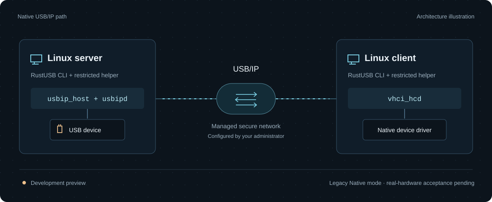
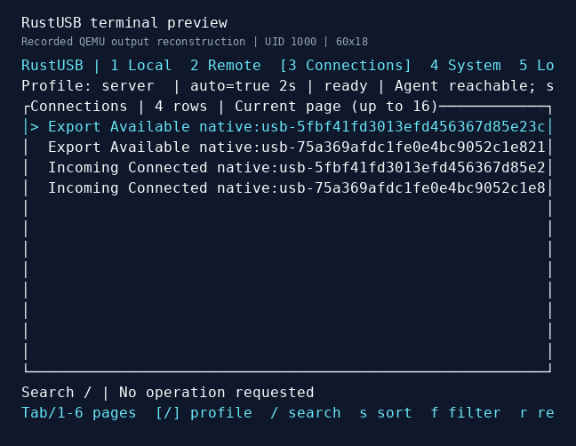

# RustUSB

[](https://github.com/tiansongyu/usbip-client/actions/workflows/ci.yml)
[](rust-toolchain.toml)
[](LICENSE)
[](docs/roadmap.md)

**USB devices, across Linux machines.** RustUSB manages USB/IP discovery, device permissions and connections through a CLI, a restricted privileged helper and optional mutual-TLS brokers.

[Website](https://tiansongyu.github.io/usbip-client/) · [Get started](#build-from-source) · [Secure guide](docs/secure-guide.md) · [Native guide](docs/native-guide.md) · [Compatibility](docs/compatibility.md) · [中文](README.zh-CN.md)

[](https://tiansongyu.github.io/usbip-client/)

RustUSB is a **development preview**. Linux Native is the default backend; optional Rust services provide fixed virtual test devices and an experimental USBFS adapter. QEMU tests exercise real Linux USB/IP paths with simulated devices. Physical hardware acceptance is still pending.

## Build from source

Use Linux with Git, native build tools and [Rust via rustup](https://rustup.rs/). The repository pins Rust 1.97.1. Ubuntu 22.04/24.04 on x86_64 and aarch64 have native software CI; USB kernel integration has been tested in x86_64 QEMU guests.

```sh
git clone https://github.com/tiansongyu/usbip-client.git
cd usbip-client
cargo build --workspace --release --locked
./target/release/rustusb --help
```

This produces `rustusb` and `rustusb-helper` in `target/release/`. Start with read-only checks:

```sh
./target/release/rustusb devices
./target/release/rustusb devices --json
./target/release/rustusb doctor
```

`devices` lists local USB metadata without changing drivers. `doctor` reports installed tools, modules and helper availability; it does not load modules, start services or test remote USB I/O. Read its individual results: exit code 0 means the diagnostic completed, not that the machine is ready to share devices.

For a live local inventory, run `./target/release/rustusb devices --watch` and stop
with Ctrl-C. Add `--json` for complete versioned batches. The
[local observation guide](docs/local-device-monitor.md) explains stale data,
resynchronization and generation boundaries.

For Native sharing, administrators must install the distribution's `usbip` / `usbipd` and matching kernel modules. On Ubuntu these tools are usually provided by `linux-tools-common` and `linux-tools-$(uname -r)`. The [Native setup guide](docs/native-guide.md) covers binary installation, helper policy, directory permissions and service setup.

## Use

Run the CLI as an ordinary user. The root helper performs only policy-approved privileged operations. The following legacy Native workflow requires both helpers and an administrator-managed VPN or secure tunnel with firewall rules for permitted peers. USB/IP itself has no authentication or encryption.

After completing the [Native setup](docs/native-guide.md), the basic workflow is:

```sh
# Server: use the approved fingerprint from `rustusb devices --json`.
rustusb export 'usb-<64-lowercase-hex-fingerprint>'

# Client: use the configured server and the Bus ID returned by discover.
rustusb discover 192.0.2.1 --port 3240 --json
rustusb attach 192.0.2.1 1-2 --port 3240
rustusb sessions
rustusb status
```

The address and Bus ID above are examples. Use your allowed endpoint and discovered device. Verify client-side USB enumeration and the device's actual function before treating the connection as working.

Stop applications using the device, then release the connection:

```sh
# Client: replace 0 with the port reported by `rustusb sessions`.
rustusb detach 0

# Server: after confirming the client has released the device.
rustusb unexport 'usb-<64-lowercase-hex-fingerprint>'
```

Each command has `--help`. Use `--json` for machine-readable output and `--log-json` for JSON tracing on stderr; `RUST_LOG` controls log verbosity. Optional [bounded file logging](docs/logging.md) adds private rotating NDJSON and authorized `rustusb logs` readers. For troubleshooting, [private diagnostic export](docs/diagnostics.md) produces bounded JSON with per-capture identity aliases:

```sh
mkdir -m 700 "$HOME/rustusb-diagnostics"
rustusb diagnostics --output "$HOME/rustusb-diagnostics/local.json" --json
```

Use a fresh filename in the private directory. Inspect the receipt for partial results; collected prerequisites do not establish USB readiness. Raw `devices --json` output may include serial numbers—redact it before sharing.

A device fingerprint is a candidate identity derived from descriptors, serial number when available and physical topology. A Bus ID is a current address. Neither is hardware authentication; a replacement without a serial number may have the same fingerprint.

### Encrypted broker mode

The optional `secure-*` commands carry the authenticated device catalog, import and subsequent URBs over mutual TLS 1.3. Follow the [secure setup guide](docs/secure-guide.md) to provision a dedicated nonroot broker account, trusted credentials and exact device rules on both endpoints, then run:

```sh
cargo build --workspace --release --all-features --locked

# Server broker: this example uses the guide's virtual HID configuration.
./target/release/rustusb secure-server --backend virtual --config /etc/rustusb/server.json

# Client broker, on the importing machine.
./target/release/rustusb secure-discover --config /etc/rustusb/client.json --json
./target/release/rustusb secure-attach --config /etc/rustusb/client.json
```

Choose `--backend native` for approved kernel exports or `--backend usbfs` for the experimental physical adapter. A Native-only CLI can use the `secure-transport` feature. Keep `secure-attach` running while using the device; SIGINT or SIGTERM starts supervised cleanup. Unconfirmed operations remain pending for administrator verification.

For supervised jobs independent of the requesting CLI, see the experimental
[application service guide](docs/application-service-guide.md). Its nonroot agent
provides fixed profiles, OS-UID action authorization, per-connection stop and
bounded durable session/audit history. Native, virtual and USBFS managed paths
have [QEMU evidence](docs/research/data-link-health-validation.md).
Remote catalog reads now run in a bounded independent task group; see the
[managed catalog validation](docs/research/catalog-supervisor-validation.md) for
slow-peer responsiveness, audit and shutdown checks.

Optional [offline CRLs](docs/offline-crl.md) can reject revoked peers at new TLS
verification, including intermediate certificates. Lists are immutable startup
inputs: renew them through cooperative service restart. Existing connections
are not hot-revoked; [validation](docs/research/offline-crl-validation.md) keeps
software and installed QEMU evidence separate.

With a configured application agent, an ordinary operator can refresh its
authenticated catalog continuously:

```sh
rustusb agent --config /etc/rustusb/agent.json discover lab-keyboard --watch --json
```

Dedicated brokers can use `secure-discover --watch`. The
[remote catalog guide](docs/remote-catalog-watch.md) explains stale data, busy
device visibility, bounded refresh and complete JSONL batches. Observation never
imports a device; its [validation](docs/research/remote-catalog-watch-validation.md)
keeps local software and installed QEMU evidence separate.

### Terminal preview

With an already configured application agent, an ordinary operator can open the
optional six-page Ratatui interface:

```sh
cargo build -p rustusb-cli --features tui --release --locked
./target/release/rustusb tui --config /etc/rustusb/agent.json
```



Recorded QEMU terminal output reconstructed for documentation; font and colors
are presentation choices. [Capture and validation](docs/research/tui-validation.md)
keep actual USB I/O and terminal coverage separate. The [TUI guide](docs/tui.md)
covers search, filters, paging, details and confirmed fixed-profile actions.
Exiting leaves service jobs running. Settings are invocation-local; complete
TUI acceptance remains open.

To observe a device's data connection, explicitly enable TLS configuration schema 2
on both endpoints, then read health from the running agent:

```sh
# After an administrator configures and starts the agent.
rustusb agent --config /etc/rustusb/agent.json health lab-keyboard
```

The opt-in v2 format measures probes and RTT on the same TLS connection as IMPORT
and USB/IP traffic. The [data-link guide](docs/data-link-health.md) covers policy,
permissions and history. Raw v1 reports probes as unavailable. A reply confirms
transport responsiveness, not USB progress or completed device cleanup.

## Choose a backend

| Backend | Device source and data path | Status |
| --- | --- | --- |
| **Linux Native** | Linux `usbip_host` and `vhci_hcd`; legacy `usbipd` or an optional TLS broker using anonymous kernel channels | Default management build; legacy interoperability and secure QEMU I/O tested |
| **Rust virtual** | Fixed virtual HID keyboard and CDC ACM echo serial profiles | Optional `rust-backend` feature; Linux client enumeration and I/O tested in QEMU |
| **Rust USBFS** | Authorized whole-device file descriptors passed by the helper to a userspace service | Experimental `physical-nusb` feature; simulated HID, FTDI and ECM tested through Linux USBFS |

All three paths use Linux VHCI on the importing side. Virtual and USBFS servers do not require `usbipd` or `usbip_host`. The Native TLS broker uses `usbip_host` without starting `usbipd`. A physical device must use one export backend at a time.

To try the virtual service locally:

```sh
cargo build -p rustusb-cli --features rust-backend --release --locked
./target/release/rustusb virtual-server --control-stdin
```

It listens on `127.0.0.1:3240` by default and accepts JSONL controls on stdin. Enter `{"id":"done","op":"shutdown"}` to stop. Importing a device still requires a configured Linux client. See the [virtual server guide](docs/rust-virtual-server.md) for test input and network options.

For USBFS, build both the service and helper with their optional features:

```sh
cargo build --workspace --release --all-features --locked
./target/release/rustusb physical-server --help
```

Follow the [physical server guide](docs/rust-physical-server.md) to authorize exact device fingerprints. Its persistent grant journal preserves unresolved original state across helper restarts and blocks new grants until resolved. Root-only reconciliation verifies administrator-restored state. A separate, default-off policy enables original-driver recovery after the owner exits, limited to the saved generation, configuration and alternate settings.

## What is verified

The latest [local inventory report](docs/research/local-device-monitor-validation.md)
records **872 software test executions at clean `c0346d6`** and **two separate
QEMU guest runs at clean `f66da6b`**, covering default and all-features builds.
An actual UID2000 CLI observes kernel USB events, interface driver changes,
removal and a new generation at the same port, then stops its real worker.

Both binaries pass three actual local process cases each: SIGINT, SIGTERM while
stdout is blocked, and an error after the output reader closes. The original
four virtual-server signal and two backpressure cases also pass. These process
checks are separate from the Cargo count. Current/stale quality, complete batches
and explicit resynchronization are required; a fingerprint does not authorize reuse.

These two guest runs validate local observation. Earlier USB/IP redirection
reports retain their actual HID/serial I/O, kernel cleanup and revision boundaries.

Earlier evidence remains available by capability:

- [Hostname and dual-stack fallback](docs/research/dual-stack-connect-validation.md): its 14 paired runs retain their tested source and actual redirected-I/O scope.
- [Authentication refusals and startup credential retirement](docs/research/secure-negative-qemu-validation.md), [TLS admission limits](docs/research/authentication-admission-validation.md), and [volatile server counters](docs/research/server-security-observations-validation.md).
- [Private diagnostic export](docs/research/diagnostic-export-validation.md), [bounded process logs](docs/research/rotating-logs-validation.md), and [cleanup before delayed records](docs/research/prepare-recording-shutdown-validation.md).
- [Data-link health](docs/research/data-link-health-validation.md), [Native interoperability](docs/research/native-qemu-matrix.md), [virtual devices](docs/research/userspace-qemu.md), and [recovery boundaries](docs/research/physical-driver-autorestore-negatives.md).

Each report retains its tested revision and original failures. Actual USB cleanup, committed business records and operational logs have distinct roles; a logging error can follow a completed USB operation. Permanent filesystem/kernel blocking can still delay exit. The [acceptance index](docs/acceptance.md) keeps the complete history. Two-machine hardware acceptance remains unverified.

## Current boundaries

- **Select the intended network mode.** `secure-*` commands require trusted mutual-TLS configuration and device rules. Legacy commands still need external network protection. `trusted_network: true` records an administrator's declaration; it does not create a secure channel. Restrict both IPv4 and IPv6 access before starting `usbipd`, which listens on wildcard addresses.
- **Use dedicated test devices.** Storage, hubs and incomplete or unsafe metadata are rejected. Do not export your active keyboard, management network adapter or production equipment.
- **Recovery has explicit limits.** The optional Rust services support cooperative shutdown; USBFS also protects unresolved grants. Opt-in recovery has two QEMU positive scenarios and three additional [upgrade, revocation and external-claim checks](docs/research/physical-driver-autorestore-negatives.md). These validate fixed simulated-device cases. General crash recovery, arbitrary FD revocation and power-loss durability testing remain unfinished.
- **Health has a defined scope.** Probes measure the data connection, not USB completion. The private agent journal upgrades to strict disk2; older agents cannot open that upgraded journal. See the [upgrade and health rules](docs/data-link-health.md).
- **Compatibility is device-specific.** The experimental USBFS backend does not support isochronous transfers. QEMU results do not establish arbitrary HID, serial, composite, camera or audio support, or aarch64 USB kernel behavior.
- **More product work remains.** Complete TUI acceptance, GUI, packaged installers, Windows USB support and the full hardware/security acceptance gates are on the [roadmap](docs/roadmap.md).

Unknown or externally created sessions are not automatically adopted. Failed or cancelled operations may have side effects; inspect current device, session and kernel state before retrying. See the [security model](docs/security.md) and [Native guide](docs/native-guide.md) for ownership and recovery rules.

## Documentation

| Start here | Details |
| --- | --- |
| [Secure broker setup](docs/secure-guide.md) | Mutual TLS, dedicated broker roles, exact device authorization and supervised cleanup |
| [Shared application service](docs/application-service-guide.md) | Nonroot jobs, authorized profiles, per-connection stop, durable sessions and bounded audit |
| [Data-link health](docs/data-link-health.md) | Opt-in v2 probes, RTT, backpressure observations and epoch-qualified history |
| [Process logs](docs/logging.md) | Private bounded rotation, authorized pages, follow and independent logging failures |
| [Private diagnostics](docs/diagnostics.md) | Bounded JSON export, committed profile history, identity aliases and checked publication |
| [Local USB observation](docs/local-device-monitor.md) | Live inventory, complete JSON batches, stale data and generation boundaries |
| [Native setup and diagnostics](docs/native-guide.md) | Helper deployment, policy, sharing and troubleshooting |
| [Virtual server](docs/rust-virtual-server.md) / [USBFS server](docs/rust-physical-server.md) | Optional service setup, controls and lifecycle boundaries |
| [Compatibility](docs/compatibility.md) / [acceptance](docs/acceptance.md) | Tested environments, device scope and unfinished gates |
| [Testing](docs/testing.md) | Software checks, isolated QEMU runners and hardware procedures |
| [Architecture](docs/architecture.md) / [protocol](docs/protocol.md) | Component boundaries and USB/IP behavior |
| [Work log](docs/work-log.md) / [requirements](docs/requirements.md) | Development history and the full project scope |

Detailed guides and research notes are currently primarily in Chinese.

## Contributing

Read [AGENTS.md](AGENTS.md) and the [development skill](.agents/skills/rustusb-development/SKILL.md) before changing USB/IP, device or privileged code. Keep changes focused, document behavior and limits, and preserve reproducible evidence for device-related fixes.

```sh
scripts/check.sh
```

This runs default and all-features checks plus the vendored library tests. QEMU prerequisites and commands are in the [testing guide](docs/testing.md). Report the backend, OS, kernel, device model and reproduction steps in [an issue](https://github.com/tiansongyu/usbip-client/issues); remove serial numbers and private USB payloads from public logs.

## License

RustUSB's own code is [MIT licensed](LICENSE). External Linux tools and drivers retain their own GPL licenses; dependencies and borrowed material are documented in [third-party notices](docs/third-party.md).
