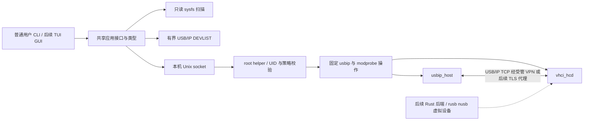

# RustUSB 技术架构

状态：Phase 0 设计草案；2026-10-22。实现范围及验证结果以工作日志为准。

## 路线

Phase 1 使用 Linux 原生数据通路，Rust 负责发现、校验、权限和操作编排。后续 Rust 后端独立实现设备服务端，复用同一领域模型和应用接口。客户端使用 Linux VHCI，不自行重写内核 USB 请求转发。



安全管理和 USB 数据通道分离。Phase 1 需要管理员预先建立可信 VPN/隧道与防火墙；没有声称内建加密。不得自动以默认全地址监听启动 usbipd。

## 工作区与依赖方向

| crate | 职责 | 允许依赖 |
| --- | --- | --- |
| rustusb-core | 领域模型、输入类型、状态、错误与后端 trait | serde、thiserror；不含系统写操作 |
| rustusb-protocol | 有界 DEVLIST 编解码、异步远端发现 | core、Tokio |
| rustusb-linux | sysfs 设备/接口/端点扫描、指纹、能力与存储检查 | core、sha2；阻塞读取在调用边界隔离 |
| rustusb-native | 固定 usbip 命令、超时、内核状态读取 | core、linux、Tokio |
| rustusb-daemon | root helper、root 管理的策略、OS 身份和 IPC；客户端库 | 前述 crate |
| rustusb-cli | clap 命令与日志 | 前述公开服务接口，不直接写 sysfs |

没有为未来 TUI/GUI/Rust 后端建立空壳 crate。

## 具体接口契约

具体可编译签名见各 crate 公共 API。设计约束：

```rust,ignore
trait DeviceDiscovery: Send + Sync {
    fn scan(&self) -> Result<Vec<Device>, Error>;
}
trait ExportBackend: Send + Sync {
    fn export(&self, bus_id: BusId)
        -> impl Future<Output = Result<(), Error>> + Send;
    fn unexport(&self, bus_id: BusId)
        -> impl Future<Output = Result<(), Error>> + Send;
}
trait ImportBackend: Send + Sync {
    fn attach(&self, peer: Peer, bus_id: BusId)
        -> impl Future<Output = Result<(), Error>> + Send;
    fn detach(&self, port: VhciPort)
        -> impl Future<Output = Result<(), Error>> + Send;
}
```

借用 self 仅存活于 future，后端为 Send + Sync；共享状态持有 Arc，特权变更串行，网络发现独立有界执行。外部超时与取消不是事务回滚：变更命令被取消后重读内核，保留可操作错误。Phase 1 不声称提供跨主机事务。

## 设备标识与状态

Bus ID 是当前寻址，不是持久身份。持久候选 ID 将 VID/PID、可用序列号和控制器/物理端口拓扑编码后散列；不在日志输出原始序列号。无序列号时身份仅绑定物理端口；同型号替换不能被可靠区分，管理员须重新核验，不能宣称硬件密码学身份。

设备描述包含 USB 类/接口和端点、驱动、速度、绑定状态以及“可发现/导出条件/实测转发”分别标记。Composite 的存储判断覆盖所有接口，不只 bDeviceClass。

状态机：Discovered → Available → Exporting → Connecting → Connected → Disconnecting → Disconnected。所有操作可进入 Error，Error/Disconnected 可经 Recovering 重新协调到 Available/Disconnected；无条件自动重连存储被禁止。未加载模块、设备消失、权限拒绝和忙分别报告。内核 sysfs 是重启后的权威状态，内存会话记录只是补充。

## 取舍与待验证

- 原生 usbip 用独立子进程复用 GPL 工具，不引入其源代码。Phase 1 不自行实现 IMPORT 后 URB 流，减少协议和内核生命周期错误。
- DEVLIST 自行实现严格的公开线协议解析，计数/设备字符串/接口有界，独立模拟端到端测试。
- helper 不接受任意命令、路径或用户可写策略；权限失败不降级为直接 root CLI。
- 设备热拔出与 sysfs 变更有竞态；操作前后重新扫描并向用户报告不确定状态。精确恢复仍须真实内核故障测试。
- 两台 Ubuntu 枚举真实 USB 是 Phase 1 必需验收，本宿主编译和 mock 测试不能替代。

## Phase 1 实际接口与截止

可编译契约位于 `rustusb-core`；`NativeBackend` 实现 ExportBackend/ImportBackend，并提供 `attach_session` 返回已验证端口、`detach_session` 在同一锁内复核身份。`rustusb-daemon::Request` 是受控特权接口，`request` 是普通前端的共享入口；没有为概念名额外建立空 SessionManager/PrivilegedOperations trait。helper 内部管理已认领会话，`sessions` 返回内核快照和是否受管。

| 操作 | 当前截止/资源边界 | 超时语义 |
| --- | --- | --- |
| DEVLIST | CLI总1–120秒，默认10秒；Native预查15秒 | 关闭socket，不进入内核导入 |
| IPC输入/输出 | 各5秒；单帧64KiB、32连接 | 错误/关闭，不开始无效请求 |
| helper变更排队 | 30秒 | 未取得锁则不开始变更 |
| native工具 | 15秒；stdout/stderr各64KiB | kill+最多2秒reap，重读内核，明确不确定副作用 |
| 内核settle | 10秒轮询；快照5秒/单属性2秒 | 不把命令成功当成状态成功 |
| 普通客户端等应答 | 120秒 | 已接受helper变更可继续完成，检查status/sessions后再操作 |

完整九状态业务状态机当前提供已测的转换类型；热插拔事件流、操作ID/进度事件、所有状态的持久超时记录、重启后未知端口认领和存储恢复仍属于Phase3，未冒充已实现。后续状态事件应包含操作ID、非敏感设备ID、from/to、稳定错误码和单调时间，使用有界事件队列；丢事件后客户端重新拉取权威快照。

## 技术依据

完整内核与 Rust 审计将写入 `research/`。Rust 2024 起点为 [1.85](https://doc.rust-lang.org/edition-guide/rust-2024/index.html)，当前构建使用安装的稳定 1.97.1；最终依赖版本以 Cargo.lock 为准。
[Tokio timeout](https://docs.rs/tokio/latest/tokio/time/fn.timeout.html) 通过丢弃 future 取消；[process Command](https://docs.rs/tokio/latest/tokio/process/struct.Command.html) 默认不终止子进程，因此实现必须 kill/reap，不能只包 timeout。
[clap derive](https://docs.rs/clap/latest/clap/_derive/) 用于一致输入解析，[tracing subscriber](https://docs.rs/tracing-subscriber/latest/tracing_subscriber/fmt/index.html) 提供人类可读/JSON 日志。上述版本在锁文件生成后记录，不用 latest 代替测试版本。
