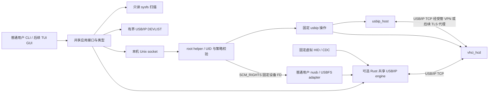

# RustUSB 技术架构

状态：已实现结构与分阶段设计约束；2026-10-23。实现范围及验证结果以工作日志为准。

## 路线

Phase 1 使用 Linux 原生数据通路，Rust 负责发现、校验、权限和操作编排。可选 Rust 后端的同一 USB/IP engine 支持固定虚拟 HID/CDC 和实验性 Linux nusb/USBFS adapter；物理 adapter 的设备来源是 helper 授权的已打开 FD。两条物理路线互斥，同一设备不能同时交给 `usbip_host` 与 USBFS。客户端使用 Linux VHCI，不自行重写内核 USB 请求转发。



安全管理和 USB 数据通道分离。Phase 1 需要管理员预先建立可信 VPN/隧道与防火墙；没有声称内建加密。不得自动以默认全地址监听启动 usbipd。

## 工作区与依赖方向

| crate | 职责 | 允许依赖 |
| --- | --- | --- |
| rustusb-core | 领域模型、输入类型、状态、错误与后端 trait | serde、thiserror；不含系统写操作 |
| rustusb-protocol | 有界 DEVLIST 编解码、异步远端发现 | core、Tokio |
| rustusb-linux | sysfs 设备/接口/端点扫描、指纹、能力与存储检查 | core、sha2；阻塞读取在调用边界隔离 |
| rustusb-native | 固定 usbip 命令、超时、内核状态读取 | core、linux、Tokio |
| rustusb-daemon | root helper、root 管理的策略、OS 身份和 IPC；客户端库 | 前述 crate |
| rustusb-cli | clap 命令与日志 | 前述公开服务接口，不直接写 sysfs |
| rustusb-rust-backend | 共享有界 USB/IP engine、两个虚拟测试 profile、可选 Linux USBFS adapter | core、protocol、Tokio；`physical-nusb` 才引入固定本地 nusb 和 rustix |

没有为未来 TUI/GUI 建立空壳 crate。CLI 的 `rust-backend` feature 选择虚拟服务；`physical-nusb` 另启用物理 adapter 和 daemon 的 `physical-usb` FD 授权接口。默认 Native 和纯虚拟构建不承担 nusb 依赖。设计分别见[虚拟服务端](research/rust-virtual-backend-design.md)与[物理 adapter](research/rust-physical-backend-design.md)；物理路径正在验证，完整 G2 尚未完成。

## 具体接口契约

具体可编译签名见各 crate 公共 API。设计约束：

```rust,ignore
trait DeviceDiscovery: Send + Sync {
    fn scan(&self) -> Result<Vec<Device>, Error>;
}
trait ExportBackend: Send + Sync {
    fn export(&self, bus_id: BusId)
        -> impl Future<Output = Result<(), Error>> + Send;
    fn unexport(&self, bus_id: BusId)
        -> impl Future<Output = Result<(), Error>> + Send;
}
trait ImportBackend: Send + Sync {
    fn attach(&self, peer: Peer, bus_id: BusId)
        -> impl Future<Output = Result<(), Error>> + Send;
    fn detach(&self, port: VhciPort)
        -> impl Future<Output = Result<(), Error>> + Send;
}
```

借用 self 仅存活于 future，后端为 Send + Sync；共享状态持有 Arc，特权变更串行，网络发现独立有界执行。外部超时与取消不是事务回滚：变更命令被取消后重读内核，保留可操作错误。Phase 1 不声称提供跨主机事务。

## 设备标识与状态

Bus ID 是当前寻址，不是持久身份。持久候选 ID 将 VID/PID、可用序列号和控制器/物理端口拓扑编码后散列；不在日志输出原始序列号。无序列号时身份仅绑定物理端口；同型号替换不能被可靠区分，管理员须重新核验，不能宣称硬件密码学身份。

设备描述包含 USB 类/接口和端点、驱动、速度、绑定状态以及“可发现/导出条件/实测转发”分别标记。Composite 的存储判断覆盖所有接口，不只 bDeviceClass。

状态机：Discovered → Available → Exporting → Connecting → Connected → Disconnecting → Disconnected。所有操作可进入 Error，Error/Disconnected 可经 Recovering 重新协调到 Available/Disconnected；无条件自动重连存储被禁止。未加载模块、设备消失、权限拒绝和忙分别报告。内核 sysfs 是重启后的权威状态，内存会话记录只是补充。

## 取舍与待验证

- 原生 usbip 用独立子进程复用 GPL 工具，不引入其源代码。Phase 1 不自行实现 IMPORT 后 URB 流，减少协议和内核生命周期错误。
- DEVLIST 自行实现严格的公开线协议解析，计数/设备字符串/接口有界，独立模拟端到端测试。
- helper 不接受任意命令、路径或用户可写策略；权限失败不降级为直接 root CLI。
- 设备热拔出与 sysfs 变更有竞态；操作前后重新扫描并向用户报告不确定状态。精确恢复仍须真实内核故障测试。
- 两台 Ubuntu 枚举真实 USB 是 Phase 1 必需验收，本宿主编译和 mock 测试不能替代。

## Phase 1 实际接口与截止

可编译契约位于 `rustusb-core`；`NativeBackend` 实现 ExportBackend/ImportBackend，并提供 `attach_session` 返回已验证端口、`detach_session` 在同一锁内复核身份。`rustusb-daemon::Request` 是受控特权接口，`request` 是普通前端的共享入口；没有为概念名额外建立空 SessionManager/PrivilegedOperations trait。helper 内部管理已认领会话，`sessions` 返回内核快照和是否受管。

| 操作 | 当前截止/资源边界 | 超时语义 |
| --- | --- | --- |
| DEVLIST | CLI总1–120秒，默认10秒；Native预查15秒 | 关闭socket，不进入内核导入 |
| IPC输入/输出 | 各5秒；单帧64KiB、32连接 | 错误/关闭，不开始无效请求 |
| helper变更排队 | 30秒 | 未取得锁则不开始变更 |
| native工具 | 15秒；stdout/stderr各64KiB | kill+最多2秒reap，重读内核，明确不确定副作用 |
| 内核settle | 10秒轮询；快照5秒/单属性2秒 | 不把命令成功当成状态成功 |
| 普通客户端等应答 | 120秒 | 已接受helper变更可继续完成，检查status/sessions后再操作 |

helper 可在读取请求前拒绝未授权 UID。普通客户端首次写入失败时，仅在同一已验证 root socket 上有界读取完整拒绝响应；不得重连重发，也不能把 EPIPE 本身解释为权限拒绝。物理 FD 的 ACK 和接收仍只发生在正常成功响应之后。

完整九状态业务状态机当前提供已测的转换类型；热插拔事件流、操作ID/进度事件、所有状态的持久超时记录、重启后未知端口认领和存储恢复仍属于Phase3，未冒充已实现。后续状态事件应包含操作ID、非敏感设备ID、from/to、稳定错误码和单调时间，使用有界事件队列；丢事件后客户端重新拉取权威快照。

## 可选 Rust 服务：共享 engine 与 USBFS 生命周期

`ServerHandle::bind` 和 Linux 可选的 `bind_physical` 委托同一 listener、wire parser 与单会话 actor。内部 `ServingBackend` 负责列表、异步 claim 和关闭协调；`SessionLease` 负责拥有请求、观察真实 completion、请求取消、回复后退休及清理。虚拟设备通过 wrapper 接入，保留已有 pending IN、FIFO 和 UNLINK 语义。Control、IN、OUT 都进入统一活动表；内部递增 ID 独立于可回绕的 wire seqnum，回复上下文不复制 OUT 数据。

| 边界 | 当前实现 |
| --- | --- |
| 网络 | 最多16连接，取得 permit 后才建立任务；JoinSet 回收所有连接任务 |
| 会话与帧 | 每会话最多64请求；每传输最多64KiB；分配前检查方向、端点、长度与不支持的 ISO |
| 截止 | 握手、收到首字节后的半包及单次写入各5秒；已导入但无数据的空闲连接不按此超时 |
| 物理缓冲 | 全服务16MiB，覆盖排队、USB在途、取消待回收和待回复数据；回复完成或网络关闭并排空队列前不提前归还 |
| 物理调度 | 每端点一个真实在途请求，其余有界 FIFO；配置/alternate 变更先协调受影响请求，后续请求等待新状态 |
| 关闭 | 停止 accept，终止并回收网络任务，再等待 backend 最多10秒；未确认清理返回隔离错误，不标为可用 |

CLI的`virtual-server`和`physical-server`共用私有`ShutdownSignals`。Unix入口在第一次await、helper通信和listener创建前同步注册SIGINT与SIGTERM；注册失败不启动服务。物理prepare只取得/校验FD和backend，尚无listener或IMPORT/claim，可在信号到达时取消；已接受的helper工作仍可能结束，已运行的spawn_blocking读取也不会被终止，runtime仍可能等待它。短bind步骤直接await取得handle，避免丢弃已开始工作的server。

取得server后，信号、控制EOF和输出错误都汇入同一次`server.shutdown().await`，cleanup错误优先。`EventOutput`先于bind创建；被信号中断的在途stdout不再重写stopped，清理完成后的末输出也可被信号中断。两种监听保留到返回，因此重复信号不通过外层select丢弃cleanup；这是源码所有权约束，未作为重复信号运行验收。非Unix保留Ctrl-C路径；helper daemon、SIGKILL/abort、跨进程监督及持久重启协调不在本次实现范围。设计及运行边界见[信号停止报告](research/server-signal-shutdown.md)。

Linux 物理 adapter 使用固定 nusb 0.2.8 本地许可源码的小扩展，保留原 usbfs 提交、取消和回收实现。扩展暴露真实 Control/端点 status、actual 和 partial 数据，允许合法的原始 IN 长度；不以扩大缓冲后丢弃字节代替正确传输。依赖版本、差异和许可见[第三方记录](third-party.md)。ISO 明确不支持；HID/FTDI 或固定虚拟 profile 的结果不证明任意 Composite、alternate、物理 CDC、摄像头或音频可用。

物理注册只接受 `PhysicalSource` 中已打开的 FD、设备元数据和代际 receipt，CLI 不接受任意 USB 路径。root helper 按调用 UID、`physical_device_ids`、可信网络声明及当前全部接口安全状态授权，打开固定 `/dev/bus/usb/BBB/DDD` 字符节点。该列表与 Native 的 `export_device_ids` 必须不相交，旧策略缺少物理列表时默认空。节点类型、权限、设备号及节点/sysfs 的 dev/inode、USB 地址前后匹配，并使用 NOFOLLOW/CLOEXEC。受保护 UDS 先交付有界 JSON，收到单字节 ACK 后才通过 SCM_RIGHTS 交付一个 FD；接收方复核 root peer、FD 数量、标记、截断和 receipt。

打开能力不等于 claim：服务在 IMPORT 时独占当前设备的全部已验证接口。slot 经 `available → claiming → leased → closing`，成功清理才回到 `available`；无法确认进入 `quarantined`，真实消失进入 `gone`。queued UNLINK 不提交硬件；active UNLINK 等真实 terminal 裁决，取消赢才回复 -104 且不再回复原 SUBMIT，完成赢则保留原 errno/partial 并回复 UNLINK0。取消不能撤回已送出的部分 OUT 数据。

显式释放使用本地nusb扩展的Linux `Interface::release_checked()`：共享引用返回Busy，最后owner只尝试一次真实RELEASEINTERFACE，保留errno且析构不重发；portable release/Drop仍维持原契约。worker逐项await所有接口并保留首错，释放失败不执行SET_CONFIGURATION；临时alternate claim也显式checked释放。ioctl成功仍不等于原状态恢复，独立config/alternate/driver/grant核验保持。实现与最终QEMU范围见[checked release报告](research/usbfs-checked-release.md)。

每个新接口 detach/claim 前，物理可选 feature 复用 `rustusb-linux` scanner 重新检查当前配置的设备身份、完整接口集合、存储驱动/块后代和外部占用；此前已取得的 usbfs 接口仅按本次持有集合放行。扫描前后核对配置和代际，配置 0 不执行接口 claim。释放自有接口后、恢复配置或驱动前也重新检查，不能在新配置已经出现危险驱动时盲目回滚。该检查不能预知所有 inactive vendor quirk 或消除外部管理员的 TOCTOU。

EOF、写失败、Drop 和 shutdown 只发起关闭。监督器保留真实请求直到回收，释放实际取得的接口；恢复 alternate 和驱动仅限本会话确证取得的原接口，不接管新外部占用。每个原接口恢复前重新观察，内核 probe 已同步恢复 sibling 或原 alternate 时不重复 claim/CONNECT；CONNECT 错误也只有实际原驱动已在同代际/原配置恢复才能收敛。仅当本会话修改过配置且当前仍匹配最后确认状态并通过安全检查时，才可恢复原配置。原配置、alternate、驱动和代际须独立核对；超时或不确定时保持隔离，不能用丢弃 future 冒充取消。热拔会关闭对应 TCP，即使没有活动 URB；旧 slot 不重新打开 Bus ID，重插需要重新核验并获取新代际 FD。

FD 是整台设备的写能力，helper 不介入后续每个 USB 请求，策略变更或关闭 helper socket 无法撤销已经交付的 FD。它不是逐请求沙箱，也没有实现可撤销的持久租约；新增的持久授权记录只协调可信服务的合作结束。部署边界见[安全模型](security.md)，使用方法见[物理服务指南](rust-physical-server.md)。干净37bc6b4的USBFS正常/热拔及原虚拟回归均已通过；软件检查不能代替双端实际 I/O、驱动恢复、热拔及真实硬件验收，最新结果见[工作日志](work-log.md)。

[SIGKILL/首次重启负向](research/physical-crash-recovery.md)已证实旧版本重启会采用空驱动为新 original。新增的 schema 1 物理授权账本在 FD 交付前保存完整原配置/接口/alternate/driver、代际与 OS owner，同指纹未决记录阻止新 grant。helper 在 root 管理的目录内用独占锁和原子文件/目录 fsync 保存，损坏和不确定提交拒绝继续使用。普通服务 shutdown 后 join 自有后台任务并释放 registry，`FinishPhysical` 验证原 OS owner 和实际原基线再退休记录；未知交付或初始化取消仍需协调。管理员只读 `PhysicalPending`/`ReconcilePhysical` 可检查恢复后的同代际或明确确认旧代际已消失，不执行恢复写入。具体契约见[实施切片](research/physical-crash-recovery-design.md)，使用方法见[指南](rust-physical-server.md)。

持久记录不是 FD 撤销或自动崩溃恢复：helper 不保留旧 USBFS OFD 来冒充独立恢复 open，原会话实际修改范围仍由后端内存管理。默认策略不自动恢复，不能仅凭 PID 消失清记录。显式opt-in的同配置/alternate CONNECT-only候选实现见下文。软件和 QEMU 证据分别记账，旧负向结果保持。

[独立句柄机制实验](research/usbfs-guardian-mechanism.md)在clean da764d0验证了独立B、A副本延长占用、另一OFD C的非抢占拒绝和B恢复后真实复用；实现位于guest-only测试工具，未改变上述产品架构或schema1权限契约。

[原驱动恢复实施设计](research/physical-driver-autorestore-design.md)新增精确设备许可和磁盘schema2的不可变恢复范围，旧record保持manual；生命周期IPC仍为1。单后台任务在原owner确已结束后独立open B，实际blocking闭包拥有helper全局变更锁，依次完整观察/CONNECT/关闭B/严格核验/持久退休。后台不跨USB调用持有journal mutex，pending仍可读；合作退出停止新工作并join已开始工作。默认关闭、每helper实例每lease最多一次尝试，任何不确定保留记录。这是实现候选，不能把上一机制实验当成本轮产品运行通过。

## 技术依据

完整内核与 Rust 审计将写入 `research/`。Rust 2024 起点为 [1.85](https://doc.rust-lang.org/edition-guide/rust-2024/index.html)，当前构建使用安装的稳定 1.97.1；最终依赖版本以 Cargo.lock 为准。
[Tokio timeout](https://docs.rs/tokio/latest/tokio/time/fn.timeout.html) 通过丢弃 future 取消；[process Command](https://docs.rs/tokio/latest/tokio/process/struct.Command.html) 默认不终止子进程，因此实现必须 kill/reap，不能只包 timeout。
[clap derive](https://docs.rs/clap/latest/clap/_derive/) 用于一致输入解析，[tracing subscriber](https://docs.rs/tracing-subscriber/latest/tracing_subscriber/fmt/index.html) 提供人类可读/JSON 日志。上述版本在锁文件生成后记录，不用 latest 代替测试版本。

## Phase 1 后续：运行诊断与内核代际协调（实施设计）

2026-10-22，基线21e98f9。上一轮交付是实质进展；当前仍按Phase1推进，不以物理设备缺席跳过可自动完成的工作，也不将后续阶段标成已实现。本节先定义本轮变更，运行结果见工作日志和独立证据。

### 运行诊断

原doctor只有Path.exists布尔值，无法证明发行版wrapper有匹配工具或socket为可信服务。新增 `rustusb_native::diagnostics::diagnose_native()`，返回可序列化的system、usbip_host、vhci_hcd、usbip、usbipd诊断。内核模块的已加载、有效sysfs和对应内核的可用模块/config证据分开；读取不到只能是unknown，不推断缺失。工具仅允许固定的`/usr/bin/usbip version`与`/usr/bin/usbipd --version`，校验可执行文件及原/canonical父链权限，固定argv与环境、读取/执行截止、输出上限、kill/reap。每个探针总截止3秒，stdout/stderr各8KiB，kill后最多2秒reap；成功退出且安全版本输出才能available，非零退出的root拒绝为requires_root，不启动服务。当前helper不加载模块。

helper诊断属于共享客户端接口：复用已有root路径/类型/权限和SO_PEERCRED验证后调用只读Status，总截止8秒，区分missing、untrusted、unreachable、timeout、permission_denied、available等结果。CLI组装两份诊断，不直接写sysfs或调用管理命令。doctor与helper Status的JSON均声明schema_version=1；旧helper无此版本会报告unexpected_response，需同时升级。NativeSession新增字段允许旧JSON反序列化为None，但无代际receipt不能授权detach。字段附可操作建议；可用组件不等于角色整体ready，角色所需组件分别列出。doctor退出0仅表示完成观察。网络、VPN、TLS、真实硬件仍明确未被doctor验证；`trusted_network`只表示管理员声明。

### 会话代际与直接重连

现有NativeSession仅有可复用的端口/local_busid/remote_devid/VIDPID，不能区分同一设备在同一端口的新连接。新增本地设备地址及sysfs目录的dev/inode代际receipt，只有状态USED且前后元信息来自同一代际才返回。Native与helper的身份比较必须包含receipt；旧ownership不得控制外部重新导入的同型号同地址设备。

在新attach产生副作用前，helper协调缓存的旧受管记录：以权威内核快照为依据，只有端口已NULL且旧设备代际已消失才移除旧记录；保留未知/仍活跃资源。对NULL端口的detach只观察旧代际，不影响同路径新代际。新attach成功后保留冲突防护；若发生本地记录冲突，使用本次已核验receipt安全清理新连接并报告结果，不能先创建内核会话再无清理地拒绝认领。

Native detach命令成功后，只对同一status属性两次已成功解析但内容不同的快照，在原settle截止内只读重观测，不重发命令。公开port_states和操作前核验仍对这种变化报错；其他读取/解析/代际错误仍立即失败，稳定的新USED身份立即拒绝。报告清理成功仍须同端口NULL与原设备代际消失，不能以“读取中变化”当成已释放。

本轮不引入完整持久会话日志、自动存储恢复或Phase3心跳状态机。内核ERROR状态身份不明时继续明确要求协调；安全拒绝不能被写成自动恢复完成。

### QEMU 验证矩阵

保留默认双guest HID两周期，增加独立场景：RustUSB export→官方Linux client、官方bind/usbipd→RustUSB client，以及受管连接被内核外部释放→直接RustUSB重连→外部释放→同port外部重新导入(旧helper必须拒绝控制)。每项要求实际输入/字节传输、驱动及资源释放，未知外部资源仍由官方工具清理。

可选QEMU usb-serial经官方6.2源码核实为FTDI FT232BM(0403:6001，厂商类、Bulk)，使用ftdi_sio并测试双向固定序号字节；它不是CDC ACM证据。只有HID reconnect场景测试代际；串口覆盖两后端端点互操作和两周期释放。三个guest多客户端争用、netem延迟/丢包、完整CDC/Rust服务端仍在原计划中，不能由本轮矩阵替代。测试只用临时VM、私有socketpair/Unix chardev；不触宿主USB、内核模块或公共网络。

## Phase1补充验收：多客户端与传输故障（实施设计）

2026-10-22，基线67c83d5。争用harness以三个独立guest内核验证单设备独占：server经两个独立私有socketpair接口分别连接client A/B；A成功导入并实际输入时，B的导入必须明确失败且无新增端口，A仍能实际输入；A释放后B可成功导入、实际输入、释放，最后server unexport恢复本地驱动。普通UID管理路径和各端授权不能用guest root直接导入代替。新测试使用独立脚本，保持此前七项harness可复现。

故障harness在已完成实际输入的连接上，由guest管理员精确中止唯一ESTABLISHED USB/IP TCP（只限隔离来宾）；核对内核端口变为NULL、旧sysfs代际消失、server AVAILABLE后，由RustUSB直接重连再验证实际输入与释放。杀usbipd进程、carrier down和本地usbip detach各有不同语义，不互相冒充。Linux普通TCP错误通常SHUTDOWN|RESET而非持久ERROR；若观测到UNKNOWN/ERROR，保留原始状态并拒绝猜测清理。此项不证明WAN黑洞检测、心跳或自动恢复存储写入。

软件平台验证扩展为Ubuntu22.04/24.04 × x86_64/aarch64原生CI，运行前以uname验证实际架构并记录系统/工具链；采用[官方标准运行器](https://docs.github.com/en/actions/reference/runners/github-hosted-runners)，结果待实际四job完成。CI不运行物理USB变更；aarch64编译/单元/只读smoke通过也不证明ARM USB/IP内核路径兼容。
